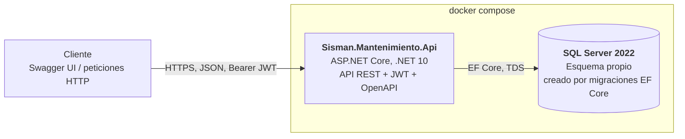
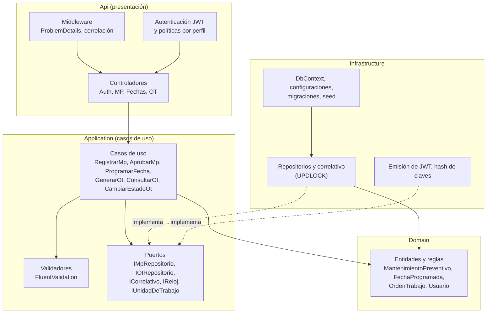

# C4 – Nivel 2: contenedores y componentes

Estado: **borrador v0.1** (2026-10-23).

## Contenedores



| Contenedor | Tecnología | Responsabilidad |
|---|---|---|
| API | ASP.NET Core 10, controladores, FluentValidation, Swashbuckle | Autenticación, validación de entradas, orquestación de casos de uso, `ProblemDetails` |
| Base de datos | SQL Server 2022 en Docker (plan B local mientras Docker no esté instalado) | Datos, restricciones, correlativo transaccional |

La API es un solo contenedor (no microservicios): el módulo es pequeño y el instructor aún no confirmó si se espera más (consulta pendiente). La arquitectura por capas permite separar servicios después.

## Componentes de la API (Clean Architecture, ADR-003)



Regla de dependencias: `Api → Application → Domain`; `Infrastructure → Application, Domain`. `Domain` no depende de nadie. `Api` solo conoce `Infrastructure` para registrar los servicios al arrancar.

## Estructura de la solución

```
src/
  Sisman.Mantenimiento.Domain/
  Sisman.Mantenimiento.Application/
  Sisman.Mantenimiento.Infrastructure/
  Sisman.Mantenimiento.Api/
tests/
  Sisman.Mantenimiento.UnitTests/
  Sisman.Mantenimiento.IntegrationTests/   (WebApplicationFactory + SQL Server de prueba)
docker/
  docker-compose.yml
```
