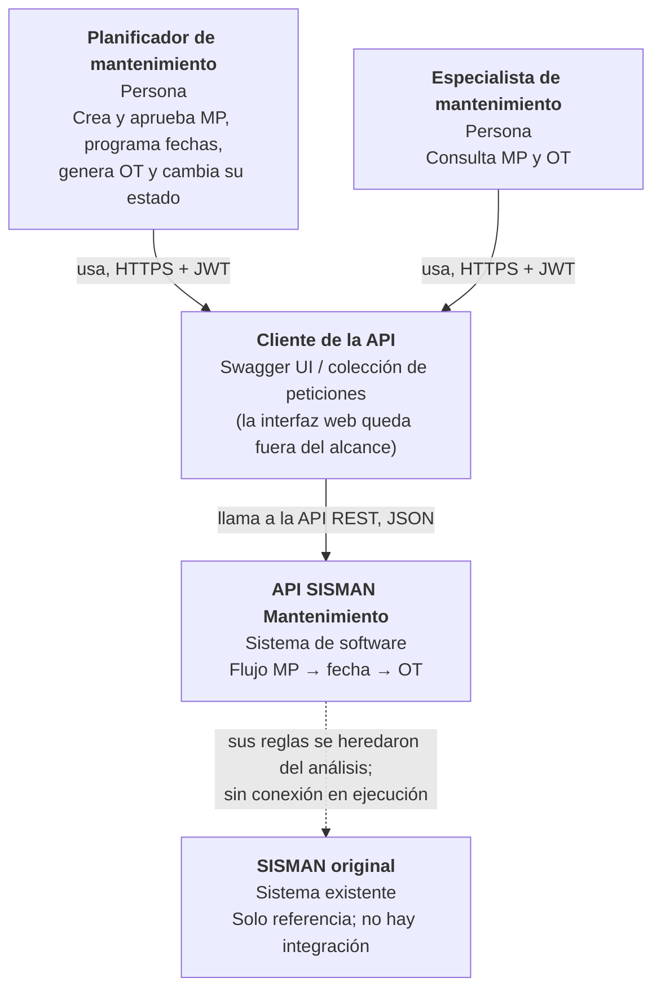

# C4 – Nivel 1: contexto del sistema

Estado: **borrador v0.1** (2026-10-23).

| Elemento | Descripción |
|---|---|
| Planificador, Especialista | Actores de `docs/alcance.md`. El perfil determina qué operaciones puede ejecutar (RN-03). |
| API SISMAN Mantenimiento | El sistema que se construye. Expone una API REST `/api/v1` documentada con OpenAPI. |
| Cliente de la API | En este proyecto: Swagger UI y una colección de peticiones. La interfaz web del producto real es otro trabajo. |
| SISMAN original | Fuente de reglas. No se conecta, no se migran sus datos ni se incluye su código. |

Fuera del contexto por decisión de alcance: seguridad compartida con otros sistemas, rotativa, reportes y la integración con BaaN.
