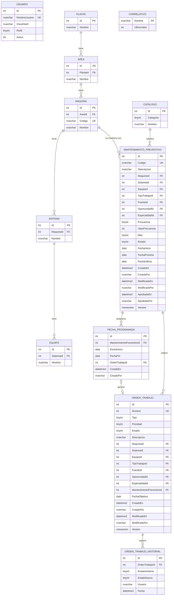

# Modelo de dominio y ERD

Estado: **borrador v0.1** (2026-10-23). Esquema propio del módulo, creado por migraciones de EF Core (ADR-001). No es una copia de la base del sistema original.

## 1. Modelo de dominio

Agregados (cada uno se modifica solo a través de su raíz):

| Agregado | Raíz | Contenido | Reglas que protege |
|---|---|---|---|
| Mantenimiento preventivo | `MantenimientoPreventivo` | Datos del MP, estado, auditoría y sus `FechaProgramada` | RN-10 a RN-16, RN-20 a RN-25 |
| Orden de trabajo | `OrdenTrabajo` | Datos copiados del MP, estado e historial de estados | RN-30 a RN-38 |
| Correlativo | `Correlativo` | Último valor por nombre (`OT`, `MP`) | RN-10, RN-32 a RN-34 |
| Usuario | `Usuario` | Nombre, hash de clave, perfil | RN-01 a RN-03 |
| Catálogos | `Catalogo`, `Planta`, `Area`, `Maquina`, `Sistema`, `Equipo` | Datos de apoyo, solo lectura para la API | RN-11 |

Objetos de valor y enumeraciones: `CodigoMp` (`MP-` + 7 dígitos), `Frecuencia` (1 Diario, 2 Semanal, 3 Mensual, 4 Anual), `EstadoMp` (Nuevo, Modificado, Aprobado), `EstadoOt` (37 a 42, RN-36), `Perfil` (Planificador, Especialista).

Comportamiento en el dominio (no en los controladores):

- `MantenimientoPreventivo.Aprobar(usuario, ahora)`, `Modificar(...)`, `ProgramarFecha(inicio, fin, hoy, usuario)` → valida RN-20 a RN-24 y actualiza las fechas del MP (RN-24).
- `FechaProgramada.EnlazarOt(numero)` → falla si ya tiene OT (RN-30).
- `OrdenTrabajo.Generar(mp, fecha, numero, usuario, ahora)` → fábrica que copia los datos (RN-31, RN-35).
- `OrdenTrabajo.CambiarEstado(nuevo, usuario, ahora)` → aplica la tabla de transiciones (RN-37) y agrega el historial (RN-38).

## 2. ERD



`CATALOGO.Categoria` distingue cuatro listas: 1 Tipo de trabajo, 2 Fuente de información, 3 Oportunidad de intervención, 4 Especialidad. Una sola tabla evita cuatro tablas idénticas.

## 3. Restricciones que garantizan las reglas

| Restricción | Regla / RNF |
|---|---|
| `UNIQUE (ORDEN_TRABAJO.Numero)` | RN-32, RNF-02 |
| `UNIQUE (MANTENIMIENTO_PREVENTIVO.Codigo)` | RN-10 |
| `UNIQUE (FECHA_PROGRAMADA.MantenimientoPreventivoId, FechaInicio)` | RN-23 |
| `UNIQUE (FECHA_PROGRAMADA.OrdenTrabajoId)` filtrado `WHERE OrdenTrabajoId IS NOT NULL` | Una OT nace de una sola fecha (RN-30) |
| `CHECK (Frecuencia BETWEEN 1 AND 4)`, `CHECK (ValorFrecuencia > 0)` | RN-12 |
| `CHECK (Frecuencia NOT IN (3,4) OR Mes BETWEEN 1 AND 12)` | RN-13 |
| `CHECK (FechaInicio <= FechaFin)` en `FECHA_PROGRAMADA` | RN-21 |
| `rowversion` en MP y OT | Dos ediciones a la vez → 409 en vez de pisarse |
| Claves foráneas en todas las relaciones | Integridad que el sistema original no tenía (4 tablas sin clave primaria) |
| Índice `IX_OT_Estado_Numero (Estado, Numero DESC)` | RN-40, RN-41, RNF-01 |

## 4. Correlativo transaccional (RN-33, RN-34)

Se toma el número en la misma transacción que crea la OT y enlaza la fecha:

```sql
UPDATE Correlativo WITH (UPDLOCK, ROWLOCK)
   SET UltimoValor = UltimoValor + 1
OUTPUT inserted.UltimoValor
 WHERE Nombre = 'OT';
```

La instrucción bloquea la fila hasta el `COMMIT`: 20 solicitudes simultáneas se ponen en cola y reciben números distintos y consecutivos. Si algo falla antes del `COMMIT`, el `ROLLBACK` devuelve el número y no quedan datos a medias. La restricción `UNIQUE` sobre `Numero` es la segunda defensa. Se ejecuta con `ExecuteSqlInterpolated` (parametrizado), no con texto concatenado (RNF-03).

## 5. Datos de ejemplo (seed)

2 usuarios (un planificador y un especialista, claves de prueba documentadas en el README), 1 planta, 3 áreas, 8 máquinas con sus sistemas y equipos, los 4 catálogos, y unos 30 MP en estados variados (la alta de MP queda fuera de la implementación, RF-01) para poder probar RF-02 a RF-09.
