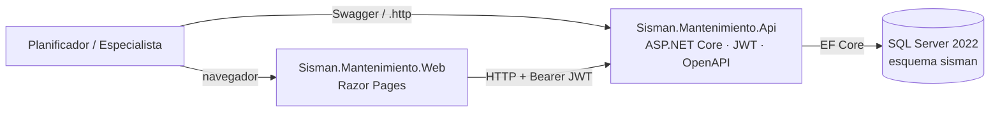

# 1. Resumen

SISMAN es el sistema con el que una editora gestiona el mantenimiento de su planta de impresión. Este proyecto reconstruye, con especificaciones primero, su flujo central: **mantenimiento preventivo (MP) → fecha programada → orden de trabajo (OT)**.

El sistema original tenía cuatro problemas que este módulo resuelve y prueba:

| Problema del original | Cómo se resuelve | Evidencia |
|---|---|---|
| El número de OT se tomaba en cuatro pasos sin transacción: dos usuarios podían recibir el mismo | Correlativo con bloqueo de fila dentro de una transacción, más restricción `UNIQUE` | Prueba de 20 solicitudes simultáneas y prueba de mutación |
| Cuando un procedimiento fallaba, la pantalla decía «éxito» | Errores `ProblemDetails` con código estable; nunca 2xx si algo falló | Pruebas de error en cada endpoint |
| Las listas de OT pesaban más de 1 MB | Paginación en el servidor | 22,9 KB por página con 26 003 OT |
| 9 de 11 pantallas abiertas sin sesión | Autenticación exigida por defecto y dos perfiles | 401 y 403 probados en cada operación |

**Resultado:** 12 requisitos funcionales y 6 no funcionales implementados; API REST con 16 operaciones; web de demostración; 121 pruebas automáticas en verde; 0 advertencias de compilación.

# 2. Alcance y requisitos

| RF | Función | Prioridad |
|---|---|---|
| RF-01 | Registrar un MP con código correlativo `MP-nnnnnnn` | M |
| RF-02 | Consultar MP con filtros y paginación | M |
| RF-03 | Editar un MP (queda «Modificado») | M |
| RF-04 | Aprobar un MP | M |
| RF-05 | Programar una fecha (inicio posterior a hoy) | M |
| RF-06 | Eliminar una fecha sin OT | S |
| RF-07 | Generar una OT con número transaccional | M |
| RF-08 | Consultar OT con filtros y paginación | M |
| RF-09 | Cambiar el estado de una OT | M |
| RF-10 | Planning: MP programados por día | S |
| RF-11 | Iniciar sesión con JWT | M |
| RF-12 | Exportar OT a Excel | C |

Las especificaciones completas están en `specs/functional/`: requisitos, 12 historias con criterios Dado/Cuando/Entonces, 9 casos de uso y 34 reglas `RN-xx`, cada una con su origen (heredada, corrige un defecto, nueva o a validar). La matriz `docs/trazabilidad.md` enlaza RF → historia → caso de uso → reglas → endpoint → clase → prueba.

**Fuera del módulo:** reportes en PDF, rotativa, asignación y consumo de personal, informe de falla, plan de trabajo, seguridad compartida con otros sistemas y migración de datos del original.

# 3. Arquitectura

## 3.1 Contexto y contenedores

Detalle en `docs/arquitectura/c4-contexto.md` y `c4-contenedores.md`.

## 3.2 Capas (Clean Architecture, ADR-003)

| Proyecto | Responsabilidad | Depende de |
|---|---|---|
| `Domain` | Entidades y reglas: `MantenimientoPreventivo` (Crear, Modificar, Aprobar, ProgramarFecha, QuitarFecha), `OrdenTrabajo` (Generar, CambiarEstado, TransicionesPermitidas) | nada |
| `Application` | Casos de uso (`MpServicio`, `OtServicio`, `ConsultasServicio`, `AutenticacionServicio`), validadores y puertos | Domain |
| `Infrastructure` | EF Core, migraciones, semilla, repositorios, transacciones y correlativo, JWT, hash de claves, exportación a Excel | Application, Domain |
| `Api` | Controladores, manejo de errores, correlación, autorización, Swagger | Application, Infrastructure |
| `Web` | Páginas Razor que llaman a la API | ninguno (cliente HTTP) |

Una solicitud recorre: controlador (HTTP y token) → caso de uso (validación de entrada) → dominio (regla de negocio) → repositorio (SQL Server). Los controladores no contienen reglas.

# 4. Modelo de datos

Esquema propio `sisman`, creado por la migración `Inicial` de EF Core (ADR-001). Doce tablas: `Usuario`, `Catalogo`, `Planta`, `Area`, `Maquina`, `Sistema`, `Equipo`, `Correlativo`, `MantenimientoPreventivo`, `FechaProgramada`, `OrdenTrabajo` y `OrdenTrabajoHistorial`. El ERD completo está en `docs/arquitectura/modelo.md`.

| Restricción | Regla que protege |
|---|---|
| `UNIQUE (OrdenTrabajo.Numero)` | RN-32: número único (segunda defensa del correlativo) |
| `UNIQUE (MantenimientoPreventivo.Codigo)` | RN-10 |
| `UNIQUE (FechaProgramada.MpId, FechaInicio)` | RN-23: no repetir el inicio |
| `UNIQUE` filtrado sobre `FechaProgramada.OrdenTrabajoId` | Una OT nace de una sola fecha |
| `CHECK` de frecuencia, valor, mes y rango de fechas | RN-12, RN-13, RN-21 |
| `rowversion` en MP y OT | Ediciones concurrentes → 409 |
| Índice `(Estado, Numero DESC)` | RN-40, RN-41, RNF-01 |

**Correlativo transaccional (RN-33, RN-34).** Dentro de la transacción se ejecuta `UPDATE Correlativo WITH (UPDLOCK, ROWLOCK) SET UltimoValor = UltimoValor + 1 OUTPUT inserted.UltimoValor`. La fila queda bloqueada hasta el `COMMIT`, así que las solicitudes simultáneas se ponen en cola; si algo falla, el `ROLLBACK` devuelve el número. Al generar una OT, además se lee la fecha con `UPDLOCK`, de modo que dos solicitudes sobre la misma fecha producen una sola OT. El mismo mecanismo (`ITransacciones`) numera los MP.

**Datos de ejemplo.** La semilla crea, solo si se habilita, 2 usuarios, catálogos, 1 planta, 3 áreas, 8 máquinas con sistemas y equipos, 30 MP en estados distintos y 3 OT. Todo es ficticio.

# 5. API

Prefijo `/api/v1`, JSON en camelCase y fechas ISO 8601. Paginación con `pagina` y `tamanoPagina` (50 por defecto y 200 como máximo). Contrato exportado de Swagger: `docs/api/openapi.json`; peticiones de ejemplo: `docs/api/sisman.http`.

| Método y ruta | RF | Perfil |
|---|---|---|
| `POST /auth/login` | RF-11 | público |
| `GET /catalogos`, `GET /maquinas` | RF-01, RF-03 | ambos |
| `POST /mantenimientos-preventivos` | RF-01 | Planificador |
| `GET /mantenimientos-preventivos`, `GET …/{id}` | RF-02 | ambos |
| `PUT /mantenimientos-preventivos/{id}` | RF-03 | Planificador |
| `POST …/{id}/aprobacion` | RF-04 | Planificador |
| `POST …/{id}/fechas` | RF-05 | Planificador |
| `DELETE …/{id}/fechas/{fechaId}` | RF-06 | Planificador |
| `POST /fechas/{fechaId}/ordenes-trabajo` | RF-07 | Planificador |
| `GET /ordenes-trabajo`, `GET /ordenes-trabajo/{id}` | RF-08 | ambos |
| `PUT /ordenes-trabajo/{id}/estado` | RF-09 | Planificador |
| `GET /planning` | RF-10 | ambos |
| `GET /ordenes-trabajo/exportacion` | RF-12 | Planificador |

**Errores (ADR-005).** Todo error es `application/problem+json` con `codigo`, `detail`, `traceId` y `correlationId`. Ejemplos de código: `validacion.error` (400, con `errors` por campo), `auth.credenciales-invalidas` (401), `mp.no-encontrado` (404), `mp.ya-aprobado`, `fecha.con-ot` y `ot.transicion-invalida` (409), y `error.interno` (500, sin detalles). Cada respuesta lleva `X-Correlation-Id`, que también aparece en el registro.

**Estados de la OT (RN-37, a validar con un usuario).** Solicitud → En programación → Pendiente; Pendiente → Concluido o Anulación; Anulación → Concluido por anulación; Concluido → Pendiente (reapertura). La OT generada nace en Pendiente.

# 6. Web de demostración

Razor Pages en `src/Sisman.Mantenimiento.Web`. Guarda el token de la API dentro de una cookie cifrada `HttpOnly` del servidor; el token no llega al navegador. Cuando la API responde 401, la web cierra la sesión y vuelve al login con un aviso. Muestra los errores de la API como texto y oculta las acciones de escritura al especialista. Usa una hoja de estilos propia, sin dependencias externas.

| Pantalla | Ruta |
|---|---|
| Login | `/login` |
| Mantenimientos preventivos: lista, detalle, alta, edición, aprobar, programar y eliminar fecha, generar OT | `/mp`, `/mp/{id}`, `/mp/nuevo`, `/mp/editar/{id}` |
| Órdenes de trabajo: lista, exportar a Excel, detalle, cambio de estado e historial | `/ot`, `/ot/{id}` |
| Planning mensual con filtros | `/planning` |

# 7. Decisiones de arquitectura

| ADR | Decisión | Alternativa descartada principal |
|---|---|---|
| ADR-001 | EF Core con esquema propio, migraciones y semilla | Llamar a los procedimientos del original (faltan 33) |
| ADR-002 | Módulo acotado en un repositorio propio y limpio | Reorganizar el repositorio de modernización (arrastraría código y un secreto) |
| ADR-003 | Clean Architecture con cuatro proyectos | Un solo proyecto por carpetas |
| ADR-004 | FluentValidation en la capa de aplicación; reglas de estado en el dominio | DataAnnotations o validar en controladores |
| ADR-005 | `ProblemDetails` con códigos estables y middleware global | Formato propio `{ ok, mensaje }` |
| ADR-006 | JWT propio de 30 minutos, PBKDF2, dos perfiles y autenticación por defecto | Reutilizar la seguridad de la empresa (no reproducible) |

Los textos completos están en `docs/adr/`.

# 8. Pruebas

| Proyecto | Pruebas | Qué cubre |
|---|---|---|
| `UnitTests` | 25 | Reglas del dominio: RN-10 a RN-16, RN-20 a RN-25, RN-30, RN-31, RN-35, RN-37, RN-38 |
| `IntegrationTests` | 84 | La API completa contra una base SQL Server propia por clase (se crea y se borra): cada endpoint, sus errores, permisos, concurrencia y rendimiento |
| `WebTests` | 10 | Las páginas contra una API simulada: sesión, perfiles, errores, antifalsificación, planning y exportación |
| **Total** | **119** | 0 fallos en 5 corridas completas seguidas |

| RNF | Resultado medido |
|---|---|
| RNF-01 Rendimiento | 13 a 47 ms y 22,9 KB por página con 26 003 OT (límite 2 s y 200 KB) |
| RNF-02 Integridad | 20 solicitudes simultáneas → 20 números distintos y consecutivos. Con el correlativo del original (leer y luego escribir), 19 de 20 fallan: la prueba detecta el defecto |
| RNF-03 Seguridad | Sin token → 401 en todo; perfil sin permiso → 403; sin secretos (`docs/calidad.md`) |
| RNF-04 Errores | `ProblemDetails` en cada caso de error probado |
| RNF-05 Reproducibilidad | Clon limpio: compila, pruebas en verde y la web arranca |
| RNF-06 Auditoría | Usuario y fecha en cada alta y cambio; historial de estados; `X-Correlation-Id` |

Además, dos recorridos HTTP de la demo contra la API y la base reales (39 comprobaciones) verificaron las pantallas de punta a punta.

# 9. Calidad

0 advertencias de compilación; ningún paquete con vulnerabilidades conocidas; cobertura de líneas de 97,6 % en el dominio, 99,3 % en aplicación, 98,0 % en la API y 95,9 % en infraestructura (sin contar migraciones). En el historial de git no hay secretos. El detalle está en `docs/calidad.md`.

# 10. Despliegue y ejecución

| Opción | Pasos |
|---|---|
| Ejecución local | Sin Docker (ADR-007). SQL Server local o LocalDB, con los comandos del README. API en `:5300/swagger` y web en `:5400` |
| Local (camino probado) | SQL Server o LocalDB; configurar con `dotnet user-secrets` las claves `Jwt:Clave`, `ConnectionStrings:Sisman`, `Migraciones:AplicarAlArrancar`, `Semilla:Habilitada`, `Semilla:ClavePlanificador` y `Semilla:ClaveEspecialista`; `dotnet run` en la API (puerto 5300) y en la web (`Api__UrlBase`, puerto 5400) |
| Pruebas | `dotnet test` (usan LocalDB o `SISMAN_TEST_CONNECTION`) |

| Configuración | Obligatoria | Dónde |
|---|---|---|
| `ConnectionStrings:Sisman` | Sí | API |
| `Jwt:Clave` (32 caracteres o más) | Sí | API |
| `Migraciones:AplicarAlArrancar`, `Semilla:*` | Para la demo | API |
| `Api:UrlBase` | Sí (por defecto `http://localhost:5300/`) | Web |

# 11. Uso de IA

Todo el trabajo se hizo con Claude Code, con la especificación como contexto. Hay 14 evidencias en `docs/ia/`: qué se pidió, qué respondió la IA, qué cambió y si se aceptó, se corrigió o se rechazó, y por qué. Ejemplos:
- Una conclusión equivocada que se corrigió (002).
- Errores de herramienta que se rehicieron (003, 006).
- La prueba de mutación que demostró que la prueba concurrente detecta el defecto real (011).
- Fallos de pruebas que resultaron ser de la propia prueba y no del sistema (011, 013, 014).

El resumen está en `docs/ia/resumen.md`.

# 12. Limitaciones y mejoras pendientes

1. Reglas a validar con un usuario: efecto de aprobar (RN-15, RN-16), no repetir fecha (RN-23) y transiciones de estado (RN-37).
2. Sin Docker: el despliegue es local (ADR-007).
3. La edición de MP no envía un token de versión del cliente; la concurrencia se detecta solo dentro de la misma solicitud.
4. Eliminar una fecha no recalcula las fechas del MP.
5. Sin *refresh token* ni bloqueo de cuenta por intentos fallidos.
6. Un fallo aislado de una prueba no reproducido (ver `docs/calidad.md`).
7. Fuera del módulo: reportes, rotativa, personal en la OT e integración con los sistemas de la empresa.
