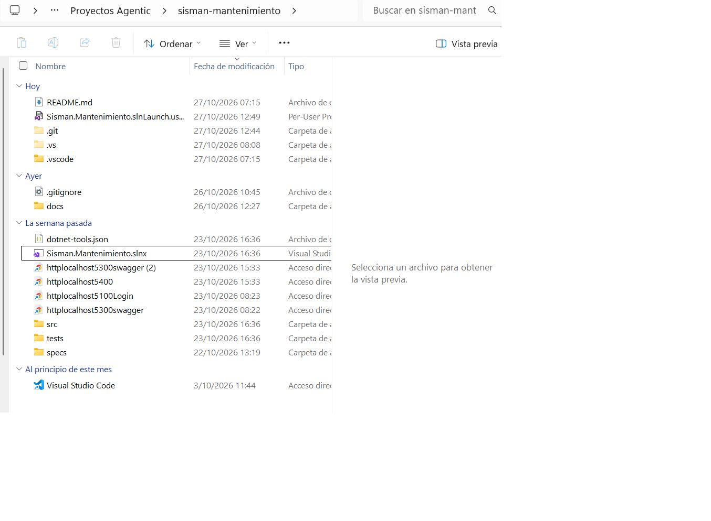

# 015 — Retiro de Docker del proyecto (ADR-007)

- **Fecha:** decisión y cambio el 2026-10-26; registrada el 2026-10-27
- **Tarea / requisito:** entorno de ejecución; estructura de entrega que pidió el instructor (carpeta `docker/`, respuesta 10 de `docs/consulta-instructor.md`)
- **Tipo:** arquitectura, documentación
- **Herramienta:** Claude Code

## Prompt

Instrucciones del responsable, tal como quedaron registradas en la decisión 2 del documento 38 v1.3 del proyecto de modernización («Plan de trabajo hasta la exposición»):

1. Primero: Docker «no es obligatorio».
2. Después: «usaremos Docker».
3. Por último: «no usaremos Docker en este proyecto» (2026-10-26).

**Origen de este texto:** es el registro de decisiones del documento 38, no el literal de cada mensaje. Los mensajes originales están en el historial de la sesión de Claude Code.

## Respuesta relevante

- Los planes 37 y 38 v1.0 a v1.2 daban prioridad a ejecutar el Docker Compose, que se había escrito pero nunca se ejecutó (Docker no está instalado en el equipo de desarrollo).
- El documento 38 v1.3 quitó Docker del plan y planteó tres opciones para la carpeta `docker/`:
  - **A.** Quitar la carpeta y los textos que la mencionan.
  - **B.** Mantenerla marcada como «no ejecutada en este proyecto», con una línea explicativa en el README.
  - **C.** Mantenerla sin cambios y explicarlo en una evidencia.
- La IA **recomendó B**: conserva la estructura que pidió el instructor y no afirma nada que no se probó.

## Cambio

- `a28a8ee` (2026-10-26): borra `docker/` (`Dockerfile`, `docker-compose.yml`, `.env.example`), crea `docs/adr/ADR-007-sin-docker.md` y actualiza README, alcance, C4 de contenedores, calidad, documento técnico, plan de trabajo, requisitos y especificación técnica (14 archivos).
- `c891d9c` (2026-10-26): la presentación quita Docker.

## Decisión

**Aceptado con corrección.** Prevaleció la opción **A**, no la B que recomendó la IA. El ADR-007 registra el motivo: mantener `docker/` «afirma un entorno que no se probó». La decisión la tomó el responsable.

Consecuencias que el ADR-007 deja escritas:

- (+) El README describe un solo camino de ejecución, que sí se probó (SQL Server local o LocalDB).
- (–) No hay arranque desde cero con un solo comando; quien evalúe necesita SQL Server local o LocalDB.
- (–) El instructor dijo que Docker es «muy recomendado y parte de la estructura esperada». Si lo exige para la entrega, hay que revisar esta decisión.

## Revisión humana

**Comprobado el 2026-10-27:**

- La carpeta `docker/` ya no existe en el repositorio.
- El README ya no menciona Docker. El documento técnico, el informe de calidad y la especificación técnica dicen «sin Docker» y remiten al ADR-007.

**Encontrado y pendiente:**

- ADR-001 (líneas 13 y 28) y ADR-006 (línea 30) siguen afirmando una base «en Docker» y «`docker compose up`». El ADR-007 dice que reemplaza esas menciones, pero los textos no tienen la nota correspondiente.
- `docs/plan-de-trabajo.md` (líneas 22 y 51) conserva criterios como «Docker disponible» y «Docker corre», que ya no aplican.
- Las evidencias 005, 009 y 013 se dejan como están: registran lo que era cierto en su fecha («No verificado: `docker compose up`»).

**Qué se habría hecho distinto:** decidir sobre Docker el primer día en lugar de escribir un Compose sin poder ejecutarlo. La decisión cambió tres veces en pocos días y costó tiempo: se redactaron los planes 37 y 38 v1.0 a v1.2 con Docker y luego quedaron superados.

## Captura

`capturas/08-arbol-sin-docker.png` (2026-10-27): raíz del repositorio con `docs`, `specs`, `src` y `tests`, sin `docker/`. El ADR-007 está en `docs/adr/` y no aparece en esta captura.

**Revisión del responsable (2026-10-28, checklist 41):** en sus palabras: «Docker quedó fuera luego de consultar al profesor». Se registra como lo dice el responsable. La respuesta escrita del instructor que está en el repositorio (24/10, evidencia 016) describe Docker como «muy recomendado y parte de la estructura esperada»; la consulta posterior no tiene registro escrito aquí.

**Precisión del responsable (2026-10-28):** el profesor confirmó **en clase, de forma verbal**, que Docker no era obligatorio. No hay registro escrito de esa confirmación; es lo que se responderá si se pregunta en la exposición. Las notas en ADR-001, ADR-006 y `plan-de-trabajo.md` se añadieron el 2026-10-28 (commit `28da902`).
