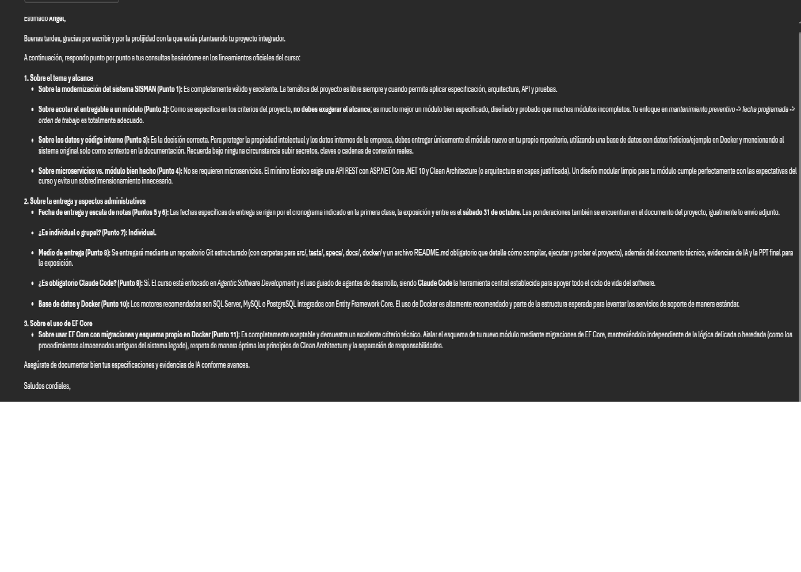

# 016 — Respuesta del instructor (2026-10-24): registro y efecto en el proyecto

- **Fecha:** respuesta recibida el 2026-10-24; registrada el 2026-10-27
- **Tarea / requisito:** consulta al instructor (`docs/consulta-instructor.md`) y requisitos del curso
- **Tipo:** documentación, análisis
- **Herramienta:** Claude Code

## Prompt

El responsable entregó la respuesta del instructor al asistente para que la registrara y revisara qué cambiaba en el proyecto.

**Origen de este texto:** el prompt literal no está en el repositorio. Los commits que lo prueban son `eacd022` (en este repositorio) y `0cbab65` («Requisitos del curso: se registra la respuesta del instructor (2026-10-24)», en el repositorio de modernización). Si se quiere el literal, está en el historial de la sesión del 2026-10-24.

## Respuesta relevante

El asistente ordenó las 11 respuestas del instructor en una tabla y añadió una columna con el efecto en el proyecto (`docs/consulta-instructor.md`):

| Tema | Respuesta del instructor | Efecto en el proyecto |
|---|---|---|
| Tema y alcance | Válido; mejor un módulo bien especificado, diseñado y probado | Confirma ADR-002 |
| Solo el módulo nuevo | Sí; sin secretos, claves ni cadenas de conexión reales | Confirma la separación de repositorios |
| Microservicios | No se requieren; basta API REST .NET 10 con Clean Architecture | El entregable es un monolito modular |
| Fecha, modalidad | Exposición y entrega el sábado 31/10; individual | Sin cambios |
| Medio de entrega | Repositorio Git con `src/`, `tests/`, `specs/`, `docs/`, `docker/` y README, más documento técnico, evidencias de IA y PPT | Revisar el README contra esa lista |
| Claude Code | Obligatorio | Sin cambios |
| Motor de base de datos y Docker | SQL Server, MySQL o PostgreSQL con EF Core; Docker «muy recomendado y parte de la estructura esperada» | Decidido el 2026-10-26: sin Docker (ver evidencia 015) |
| EF Core con esquema propio | Aceptable | Confirma ADR-001 |

La recomendación final del instructor fue documentar bien las especificaciones y las evidencias de IA conforme se avanza. Esta evidencia y la 015 responden a ella.

## Cambio

- `eacd022` (2026-10-24): `docs/consulta-instructor.md`, 21 líneas añadidas y 2 cambiadas.
- `0cbab65` (2026-10-24), en el repositorio de modernización: registro en `Requisitos-para-aprobar.md`.

## Decisión

**Aceptado, con una excepción documentada.** Todas las respuestas confirman las decisiones ya tomadas (ADR-001, ADR-002, separación de repositorios). La excepción es Docker: el instructor lo considera parte de la estructura esperada y el proyecto no lo usa (ADR-007, evidencia 015).

## Revisión humana

- Se cruzó cada fila con `Requisitos-para-aprobar.md` y con la estructura de entrega que pidió el instructor. La única diferencia con esa estructura es la carpeta `docker/`, ausente por decisión.
- La columna «Respuesta del instructor» resume el mensaje recibido; la columna «Efecto en el proyecto» es interpretación del asistente. **Cotejada con el mensaje original el 2026-10-28** (captura 09): la primera columna lo resume con fidelidad. Única omisión: además del punto 10, los puntos 3 («base de datos con datos ficticios/ejemplo en Docker») y 11 («esquema propio en Docker») también mencionan Docker; no cambia la decisión del ADR-007.
- Las preguntas 3 y 11 de la consulta presuponían Docker. Se dejan como se enviaron, porque documentan lo que se preguntó.
- Riesgo abierto: si el instructor exige `docker/` al evaluar, hay que revisar el ADR-007.

## Captura

`capturas/09-mensaje-instructor.png` (2026-10-28): mensaje original del instructor con las respuestas a los puntos 1 a 11. El responsable quitó los datos personales antes de guardarla.
