# 1. Qué es SISMAN Mantenimiento

SISMAN Mantenimiento organiza el **mantenimiento preventivo** de la planta en tres pasos:

| Paso | Qué es | Ejemplo |
|---|---|---|
| **Mantenimiento preventivo (MP)** | Un trabajo que se repite con una frecuencia | «Lubricar rodamientos del rodillo principal, cada mes» |
| **Fecha programada** | El día en que toca hacer ese MP | «El 30/10» |
| **Orden de trabajo (OT)** | La orden que se genera para ejecutar el MP en esa fecha | «OT 4: lubricar rodamientos el 30/10, prioridad Alta» |

El sistema se usa desde el navegador. No hace falta instalar nada.

## 1.1 Perfiles

Cada persona entra con un usuario, y su **perfil** decide qué puede hacer:

| Tarea | Planificador | Especialista |
|---|:-:|:-:|
| Ver mantenimientos preventivos, órdenes de trabajo y planning | Sí | Sí |
| Registrar y editar mantenimientos preventivos | Sí | No |
| Aprobar mantenimientos preventivos | Sí | No |
| Programar y eliminar fechas | Sí | No |
| Generar órdenes de trabajo | Sí | No |
| Cambiar el estado de una orden de trabajo | Sí | No |
| Exportar órdenes de trabajo a Excel | Sí | No |

Las acciones que un perfil no puede hacer **no aparecen** en su pantalla.

## 1.2 Estados de un mantenimiento preventivo

| Estado | Significa | Qué se puede hacer |
|---|---|---|
| **Nuevo** | Recién registrado | Editarlo y aprobarlo |
| **Modificado** | Se editó después de registrarlo o de aprobarlo | Aprobarlo de nuevo |
| **Aprobado** | Listo para programarse | Programar fechas y generar órdenes de trabajo |

## 1.3 Estados de una orden de trabajo

La OT nace en **Pendiente** y solo puede pasar a los estados de esta tabla. El sistema muestra únicamente los cambios permitidos desde el estado actual.

| Desde | Puede pasar a |
|---|---|
| Solicitud | En programación |
| En programación | Pendiente |
| **Pendiente** | Concluido o Anulación |
| Concluido | Pendiente (reabrir) |
| Anulación | Concluido por anulación |
| Concluido por anulación | No admite más cambios |

# 2. Acceso al sistema

## 2.1 Iniciar sesión

1. Abra en el navegador la dirección que le indique el área de sistemas.
2. Escriba su **usuario** y su **clave**.
3. Pulse **Ingresar**.

Si el usuario o la clave no son correctos, aparece el aviso «Usuario o clave incorrectos.» Por seguridad, el aviso no indica cuál de los dos está mal.

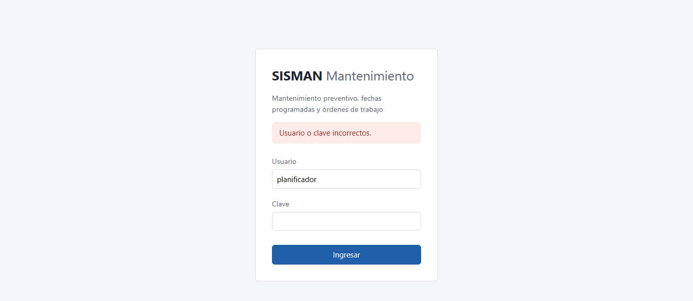

## 2.2 El menú

Arriba de cada pantalla está el menú, con tres opciones:
- **Mantenimientos preventivos**
- **Órdenes de trabajo**
- **Planning**

A la derecha se ven su usuario y su perfil, y el botón **Salir**.

## 2.3 Cerrar sesión y sesión vencida

- Pulse **Salir** para terminar. Hágalo siempre si usa una PC compartida.
- Por seguridad, la sesión **vence a los 30 minutos** de iniciada. Cuando vence, el sistema lo lleva al inicio con el aviso «La sesión venció. Vuelva a iniciar sesión.» Lo que no llegó a guardar debe ingresarlo otra vez.

## 2.4 Avisos

Después de cada acción aparece un aviso arriba de la pantalla:
- **Verde:** la acción se hizo, por ejemplo «El MP-0000031 quedó aprobado.»
- **Rojo:** la acción **no** se hizo y el aviso dice por qué, por ejemplo «La fecha de inicio debe ser posterior a hoy.» Nada queda grabado a medias.

# 3. Perfil Planificador

## 3.1 Consultar mantenimientos preventivos

1. En el menú, elija **Mantenimientos preventivos**.
2. Para buscar, escriba el **código** (o parte de él, por ejemplo `MP-00000`), elija un **estado** y pulse **Buscar**. **Limpiar** quita los filtros.
3. La lista muestra 50 por página. Use **Siguiente** y **Anterior** para moverse; los filtros se mantienen.
4. Pulse el **código** de un MP para ver su detalle.

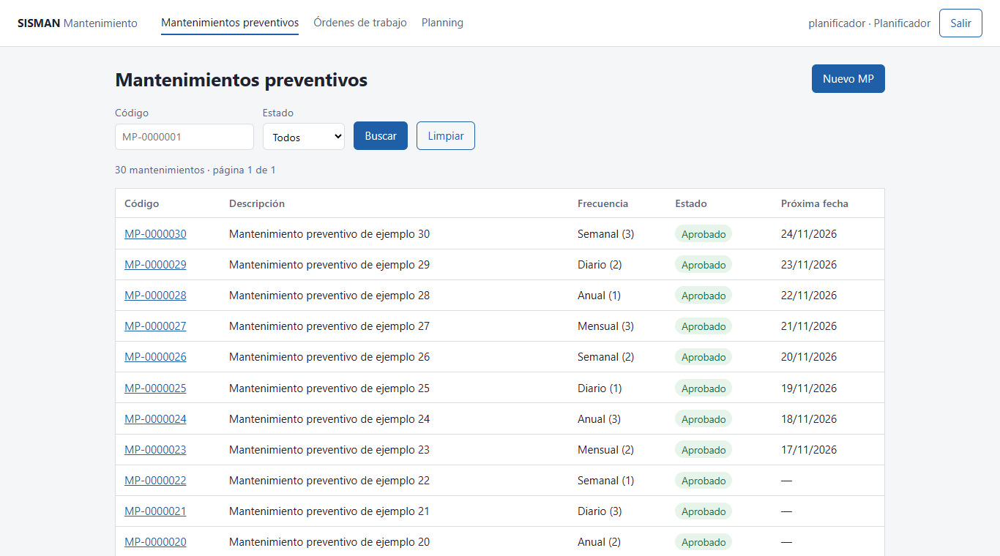

## 3.2 Registrar un mantenimiento preventivo

1. En la lista de mantenimientos preventivos, pulse **Nuevo MP**.
2. Complete el formulario:

| Campo | Qué poner | Obligatorio |
|---|---|:-:|
| Descripción | Qué hay que hacer, hasta 200 caracteres | Sí |
| Máquina | La máquina donde se hace el trabajo | Sí |
| Sistema | El sistema de esa máquina | No |
| Equipo | El equipo de ese sistema | No |
| Tipo de trabajo | Lubricación, inspección, limpieza, ajuste, cambio de repuesto | Sí |
| Fuente de información | De dónde sale el trabajo (manual del fabricante, historial de fallas, experiencia del operador) | Sí |
| Oportunidad de intervención | Cuándo se puede hacer (máquina detenida, cambio de turno, parada programada) | Sí |
| Especialidad | Mecánica, eléctrica, electrónica, instrumentación | Sí |
| Frecuencia | Diario, semanal, mensual o anual | Sí |
| Cada (valor) | Cada cuántas unidades de la frecuencia (por ejemplo, «cada 2» semanas) | Sí |
| Mes | El mes, **solo** si la frecuencia es mensual o anual | Según frecuencia |

3. Pulse **Registrar**.

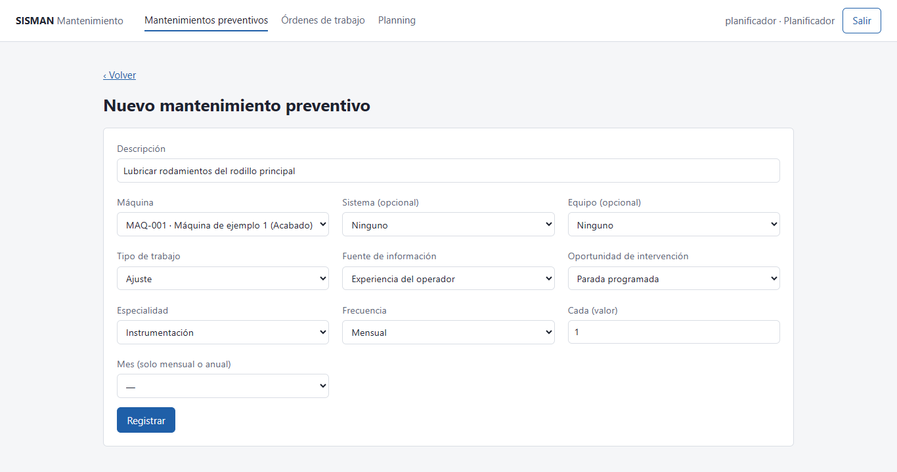

Si falta un dato, el sistema lo indica y no registra nada. Por ejemplo, con frecuencia mensual sin mes:

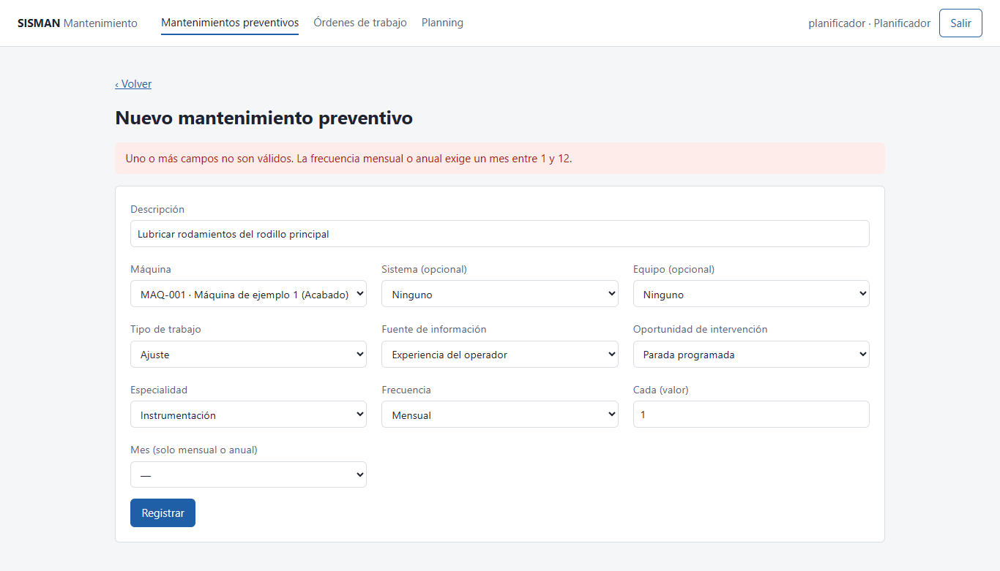

Al registrarlo, el sistema le asigna un **código** (`MP-` y siete dígitos) y lo deja en estado **Nuevo**:

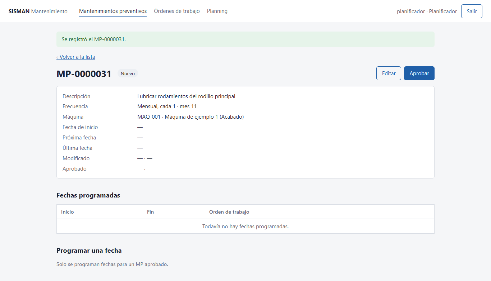

> El sistema y el equipo se eligen de listas agrupadas por máquina. Si elige un equipo que no pertenece al sistema o a la máquina indicada, el sistema lo rechaza con un aviso.

## 3.3 Editar un mantenimiento preventivo

1. En el detalle del MP, pulse **Editar**.
2. Cambie lo necesario y pulse **Guardar cambios**.

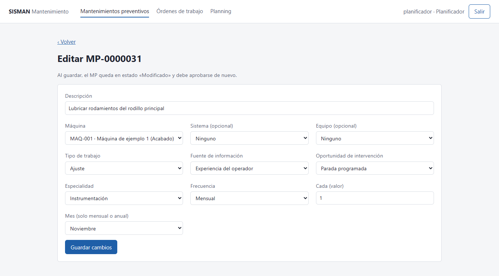

Al guardar, el MP queda en estado **Modificado**, con su usuario y la hora. Un MP modificado **debe aprobarse de nuevo** antes de programarle fechas.

## 3.4 Aprobar un mantenimiento preventivo

1. En el detalle de un MP Nuevo o Modificado, pulse **Aprobar**.
2. El estado pasa a **Aprobado** y se registran su usuario y la hora.

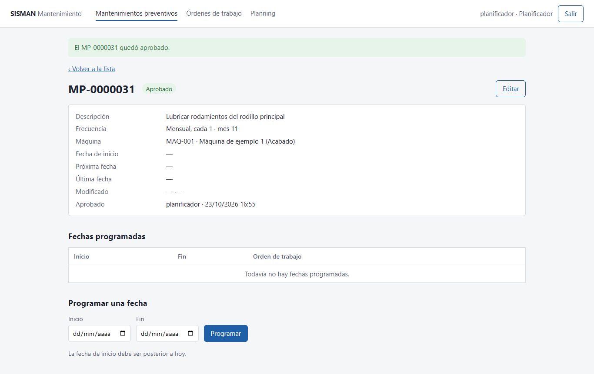

Un MP que ya está aprobado no muestra el botón **Aprobar**.

## 3.5 Programar una fecha

Solo se programan fechas para un MP **Aprobado**.

1. En el detalle del MP, en **Programar una fecha**, elija el **inicio** y el **fin**.
2. Pulse **Programar**.

Reglas:
- La fecha de inicio debe ser **posterior a hoy**.
- El inicio no puede ser posterior al fin.
- No se puede repetir el mismo día de inicio en el mismo MP.

Si no se cumple una regla, aparece un aviso rojo y no se graba nada:

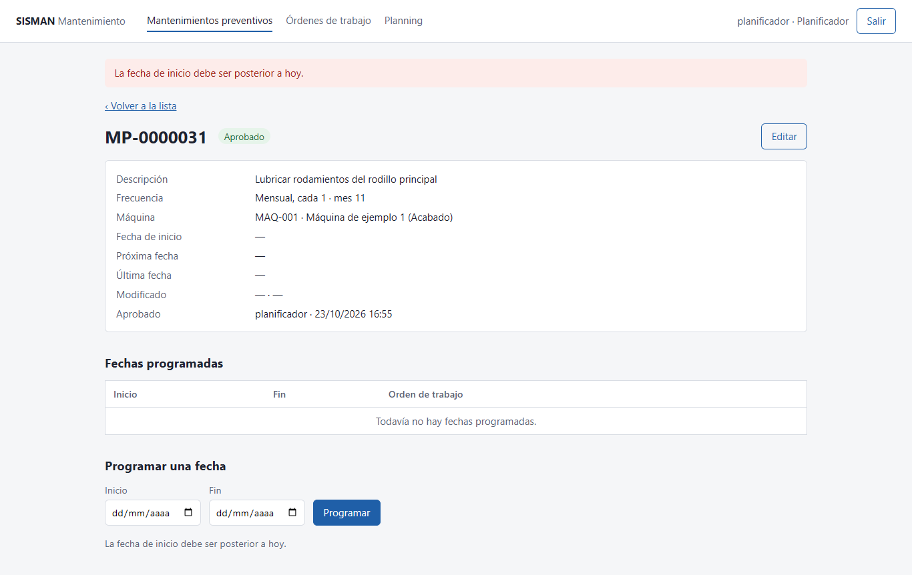

Las fechas programadas aparecen en la tabla **Fechas programadas**, con «Sin OT» hasta que se genere su orden de trabajo:

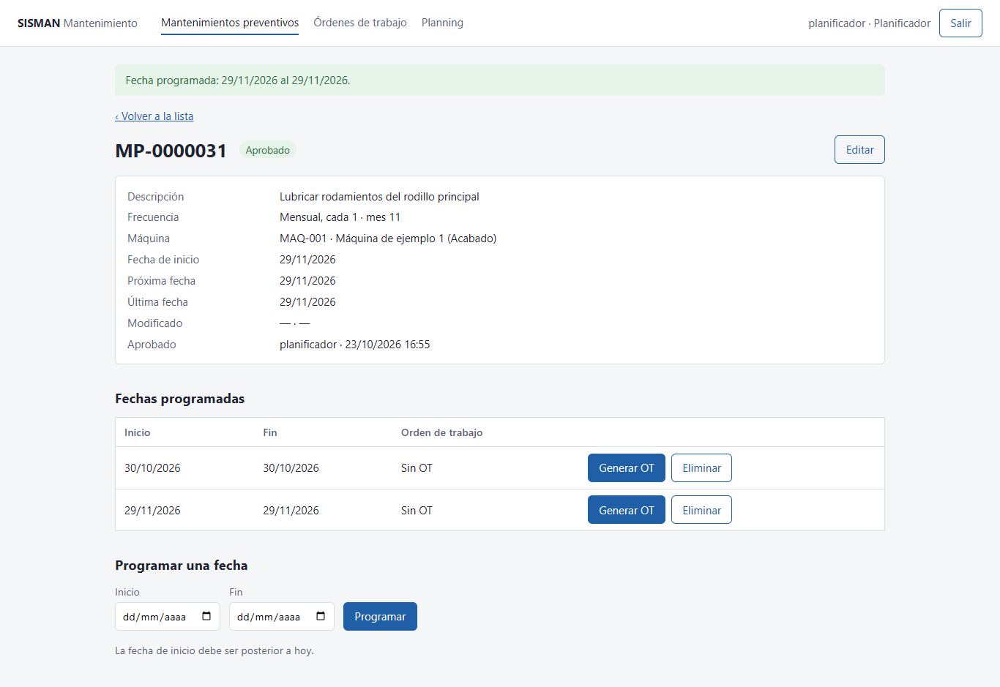

> Al programar una fecha, el MP actualiza su fecha de inicio, su próxima fecha y su última fecha con la fecha recién programada.

## 3.6 Eliminar una fecha

1. En **Fechas programadas**, pulse **Eliminar** en la fecha que quiere quitar.
2. Confirme en el mensaje del navegador.

Solo se pueden eliminar las fechas que **todavía no tienen OT**. Las que ya la tienen no muestran el botón.

## 3.7 Generar una orden de trabajo

1. En **Fechas programadas**, pulse **Generar OT** en la fecha que corresponde.
2. El sistema crea la OT y lo lleva a su detalle.

La OT nace con:
- Estado **Pendiente**, prioridad **Alta** y tipo **Preventivo**.
- La descripción, la máquina y los datos del MP.
- Como **fecha objetivo**, el inicio de la fecha programada.

El número de OT es **único**: aunque varias personas generen órdenes al mismo tiempo, nunca se repite.

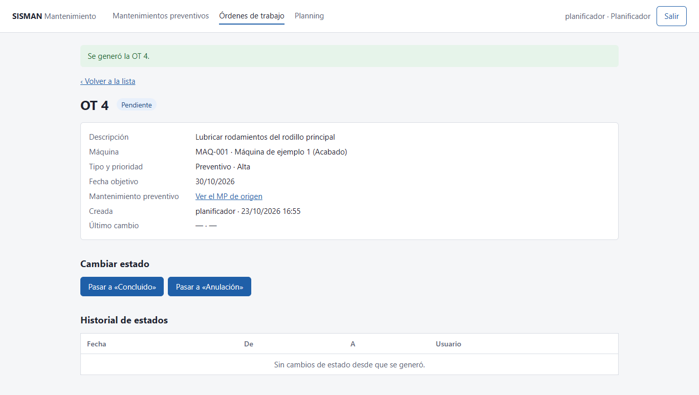

## 3.8 Cambiar el estado de una orden de trabajo

1. En el detalle de la OT, en **Cambiar estado**, pulse el botón del estado al que quiere pasar. Solo aparecen los cambios permitidos (ver 1.3).
2. El cambio queda en el **Historial de estados**, con la fecha, el estado anterior, el nuevo y su usuario.

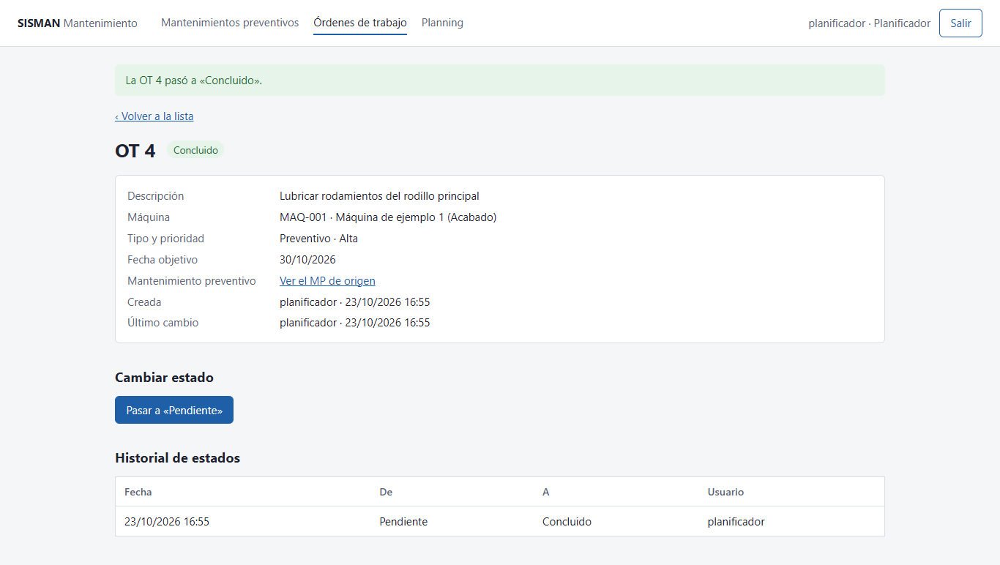

Una OT **Concluida** se puede **reabrir** (pasar a Pendiente) si el trabajo debe rehacerse.

## 3.9 Consultar órdenes de trabajo

1. En el menú, elija **Órdenes de trabajo**.
2. Filtre por **número** o **estado** y pulse **Buscar**.
3. La lista está ordenada de la OT más reciente a la más antigua y muestra 50 por página.
4. Pulse el **número** para ver el detalle.

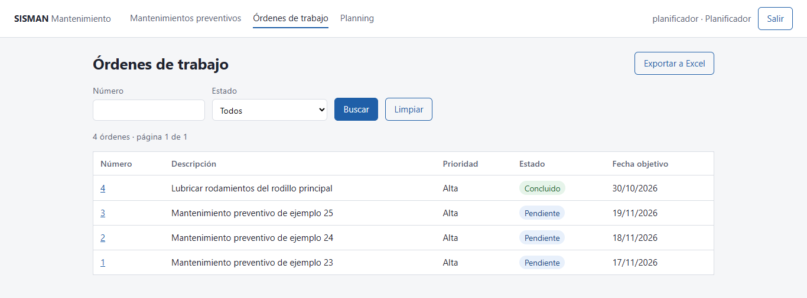

Ejemplo con el filtro de estado «Concluido»:

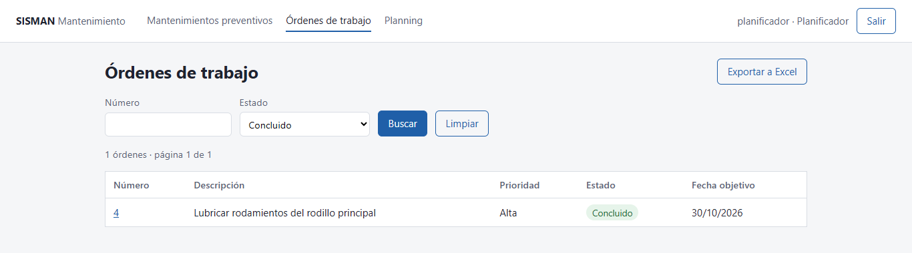

## 3.10 Exportar órdenes de trabajo a Excel

1. En **Órdenes de trabajo**, aplique los filtros que quiera.
2. Pulse **Exportar a Excel**.
3. El navegador descarga un archivo `.xlsx` con **todas** las OT del filtro, no solo las de la página que está viendo.

El archivo tiene una fila por OT con su número, estado, prioridad, tipo, descripción, fecha objetivo y quién la creó o la cambió. Si el filtro abarca más de 10 000 órdenes, el sistema le pide afinarlo.

## 3.11 Planning

1. En el menú, elija **Planning**.
2. El calendario muestra, para cada día del mes, **cuántos mantenimientos preventivos hay programados que todavía no tienen OT**. Los días con trabajo aparecen resaltados y el día de hoy, con un borde.
3. Use **Mes anterior** y **Mes siguiente** para cambiar de mes.
4. Filtre por **planta**, **área**, **máquina** o **especialidad** y pulse **Filtrar**.

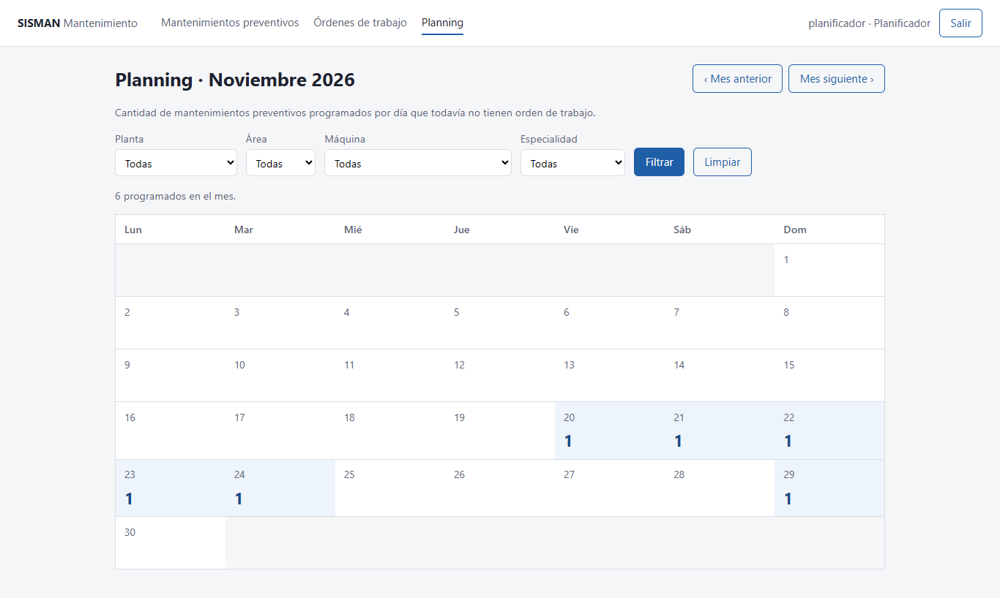

> El planning sirve para ver la carga de trabajo pendiente de generar: cuando se genera la OT de una fecha, esa fecha deja de contarse.

# 4. Perfil Especialista

El especialista **consulta**: ve los mismos mantenimientos preventivos, órdenes de trabajo y planning que el planificador, pero sin botones para registrar, editar, aprobar, programar, generar, cambiar estado ni exportar.

## 4.1 Consultar mantenimientos preventivos

Igual que en 3.1, pero sin el botón **Nuevo MP**:

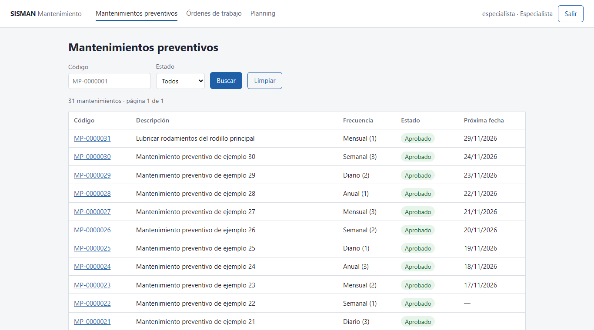

En el detalle ve los datos y las fechas programadas, con el número de OT de cada una:

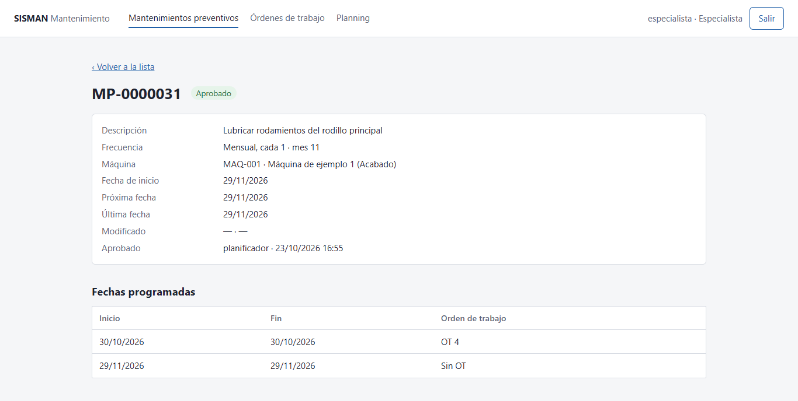

## 4.2 Consultar órdenes de trabajo

Igual que en 3.9. En el detalle ve el historial de estados, pero no la sección **Cambiar estado**:

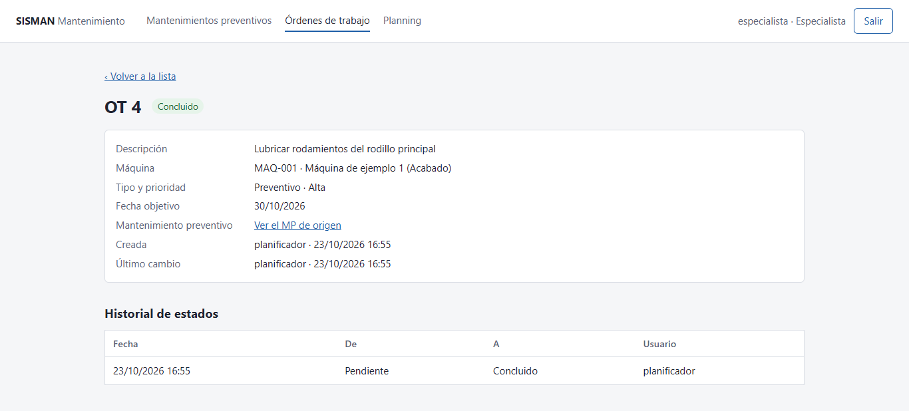

## 4.3 Planning

Igual que en 3.11.

# 5. Avisos frecuentes

| Aviso | Qué significa | Qué hacer |
|---|---|---|
| Usuario o clave incorrectos. | Los datos no coinciden | Revise mayúsculas y vuelva a intentar; si sigue, pida ayuda a sistemas |
| La sesión venció. Vuelva a iniciar sesión. | Pasaron 30 minutos desde que inició sesión | Inicie sesión de nuevo y repita lo que no se guardó |
| La frecuencia mensual o anual exige un mes entre 1 y 12. | Eligió mensual o anual sin indicar el mes | Elija el mes |
| No existe el equipo (o no pertenece al sistema) indicado. | El equipo elegido es de otro sistema o máquina | Elija un equipo del sistema y la máquina correctos |
| El MP-… ya está aprobado. | El MP ya estaba aprobado | Nada; si cambió algo, edítelo y apruébelo de nuevo |
| El MP-… no está aprobado. | Intentó programar o generar con un MP sin aprobar | Apruebe el MP primero |
| La fecha de inicio debe ser posterior a hoy. | Eligió hoy o un día pasado | Elija una fecha a partir de mañana |
| Ya existe una fecha programada con ese inicio. | Ese MP ya tiene una fecha con ese día de inicio | Elija otro día |
| La fecha ya tiene una orden de trabajo. | La fecha ya generó su OT | Busque la OT en «Órdenes de trabajo» |
| No se puede pasar de «…» a «…». | Ese cambio de estado no está permitido | Revise la tabla de 1.3 |
| Su perfil no permite esta operación. | Su perfil no tiene permiso | Pida la acción a un planificador |
| No se pudo conectar con la API. | El servicio del sistema no responde | Avise al área de sistemas |

# 6. Preguntas frecuentes

**¿Puedo deshacer una aprobación?**
No directamente. Si edita el MP, vuelve a quedar «Modificado» y debe aprobarse otra vez.

**¿Por qué no veo el botón «Generar OT»?**
Hay tres motivos posibles: el MP no está aprobado, la fecha ya tiene OT o su perfil es Especialista.

**¿Por qué no veo el botón «Eliminar» en una fecha?**
Porque esa fecha ya tiene una orden de trabajo.

**¿Se puede anular una OT?**
Sí, desde Pendiente: **Pasar a «Anulación»** y luego **Pasar a «Concluido por anulación»**.

**¿Quién hizo un cambio?**
En el detalle del MP figuran quién lo modificó y quién lo aprobó, y en el detalle de la OT, el historial de estados con el usuario de cada cambio.

**¿Qué pasa si dos personas generan una OT al mismo tiempo?**
Cada una recibe un número distinto. Si las dos intentan generar la OT de la **misma** fecha, solo una lo logra; la otra ve el aviso «La fecha ya tiene una orden de trabajo.»

# 7. Glosario

| Término | Significado |
|---|---|
| MP | Mantenimiento preventivo |
| OT | Orden de trabajo |
| Fecha programada | Día en que toca ejecutar un MP |
| Fecha objetivo | Fecha en que debe hacerse una OT; es el inicio de su fecha programada |
| Planning | Calendario con la carga de MP programados sin OT |
| Perfil | Conjunto de permisos de un usuario: Planificador o Especialista |

*Historial de versiones: v1.0 — primera versión, con pantallas capturadas del sistema el 2026-10-23.*
